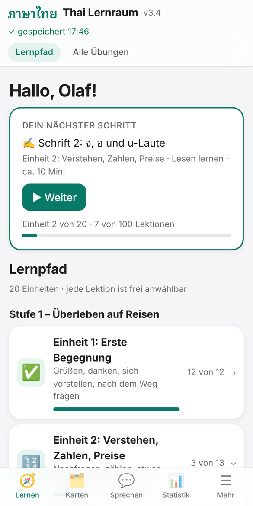
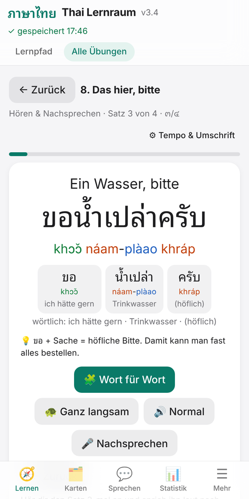
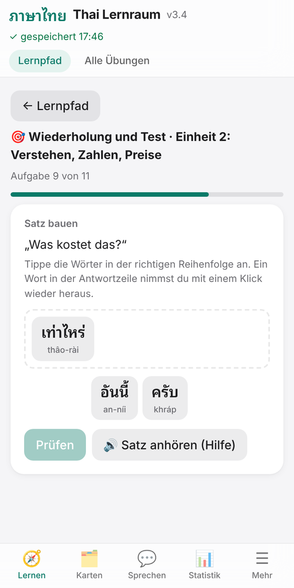
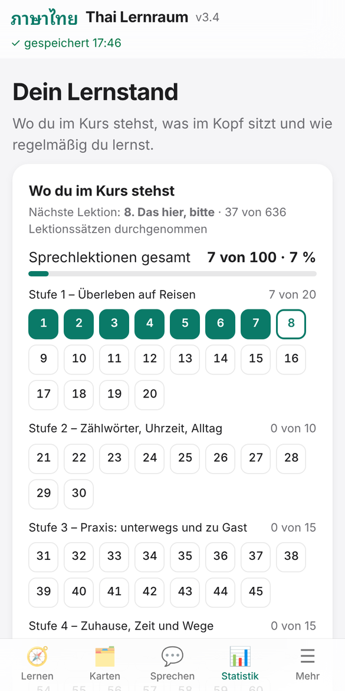

# Thai Lernraum

Thailändisch lernen für Deutschsprachige – im Browser, kostenlos, ohne Anmeldung.

**▶ Direkt ausprobieren: [margowski.github.io/thai-lernraum](https://margowski.github.io/thai-lernraum/)**

Die App läuft auf PC und Handy, lässt sich wie eine App installieren und funktioniert danach auch ohne Internet.

<p>
  
  
  
  
</p>

## Warum noch eine Thai-App?

Die meisten Thai-Kurse erklären auf Englisch und lassen einen Sätze nachsprechen, ohne zu zeigen, wie sie gebaut sind. Thai Lernraum erklärt auf Deutsch und zeigt zu jedem Satz, welches Wort was bedeutet:

```
ขอ          น้ำเปล่า     ครับ
khɔ̌ɔ        náam-plàao   khráp
hätte gern  Trinkwasser  (höflich)
```

Wer sieht, dass Thai „hätte gern – Trinkwasser – höflich“ sagt, kann den nächsten Satz selbst bauen.

## Was drin ist

- **100 Lektionen in 20 Einheiten**, vom ersten „Hallo“ bis zu Arztbesuch, Behörde und Besuch bei den Schwiegereltern. Jeder Satz mit Thai-Schrift, Umschrift mit Tönen, Übersetzung und Wort-für-Wort-Zeile.
- **Lernpfad:** Die App zeigt immer den einen nächsten Schritt. Jede Lektion ist trotzdem frei anwählbar.
- **Merkzettel** je Einheit: die Grammatik dahinter, kurz und mit Beispielen aus den Lektionen.
- **Wiederholung mit Test** nach je fünf Lektionen: hören und verstehen, Sätze erkennen, Sätze aus Wörtern bauen.
- **Karteikasten** mit Wendekarten und fünf Fächern. Was du vergisst, kommt früher wieder.
- **23 Hördialoge** mit Verständnisfragen.
- **Schriftkurs** in acht Lektionen, dazu ein Training für leicht verwechselbare Zeichen und Laute.
- **Satzbaukasten:** eigene Sätze aus bekannten Mustern zusammensetzen.
- **Kulturhinweis** zu jeder Lektion – vom Wai bis zum Umgang mit Behörden.
- **Lernstatistik:** Stand im Kurs, Wortschatz, Trefferquote, die letzten 30 Tage.
- **Männer- und Frauenform:** Die App stellt alle Sätze auf ผม/ครับ oder ฉัน/ค่ะ um.

Mit eigenem KI-Schlüssel kommen dazu: eine **Tutorin**, die Gespräche führt und korrigiert, **Rollenspiele** (Restaurant, Taxi, Markt …) und ein **Übersetzer**, der jeden Satz Wort für Wort erklärt.

## So fängst du an

1. [Die App öffnen](https://margowski.github.io/thai-lernraum/), drei Fragen beantworten, erste Lektion starten.
2. Installieren, wenn du magst:
   - **Android (Chrome):** Menü ⋮ → „App installieren“
   - **iPhone (Safari):** Teilen-Symbol → „Zum Home-Bildschirm“
   - **PC (Chrome, Edge):** Symbol rechts in der Adresszeile
3. Wer schon etwas Thai kann, wählt beim Start „Einfache Sätze“ und überspringt per Einstufung, was sitzt.

Am besten funktioniert die App in **Chrome**. Für die Sprachausgabe braucht das Gerät eine Thai-Stimme; Android bringt sie meist mit, unter Windows lässt sie sich in den Spracheinstellungen nachinstallieren.

## Was ohne und was mit KI-Schlüssel geht

| | ohne Schlüssel | mit eigenem Anthropic-Schlüssel |
|---|---|---|
| Lektionen, Merkzettel, Tests | ✓ | ✓ |
| Karteikarten, Hördialoge, Schriftkurs, Statistik | ✓ | ✓ |
| Tutorin, Rollenspiele | – | ✓ |
| Übersetzer | nur Thai in Wörter zerlegen | ✓ |

Der Schlüssel ist freiwillig. Er wird in den Einstellungen eingetragen, bleibt auf dem eigenen Gerät und geht nur an Anthropic. Die KI-Nutzung rechnet Anthropic mit dir ab.

## Ehrlicher Stand

- **Die Thai-Inhalte sind noch nicht vollständig von Muttersprachlern geprüft.** Die Prüfung läuft. Fehler bei Wortwahl, Tönen oder Umschrift sind möglich.
- **Der Ton kommt von der Computerstimme des Geräts**, nicht von echten Sprechern. Die Qualität hängt vom Gerät ab. Für eigene Aufnahmen gibt es in den Einstellungen ein Aufnahmestudio.
- Die App ist ein privates Projekt eines Lerners, kein Produkt eines Verlags. Sie ersetzt keinen Sprachkurs mit Lehrer und keine Gespräche mit Thais.

Einen Fehler gefunden oder eine Idee? Gern als [Issue](https://github.com/Margowski/thai-lernraum/issues) melden – besonders willkommen sind Korrekturen von Muttersprachlern.

## Deine Daten

- Der Lernstand liegt im Browser des eigenen Geräts. Es gibt kein Konto, keine Werbung und keine Auswertung des Nutzungsverhaltens.
- Es gibt keinen Server, der Lernstände fremder Nutzer speichert. Wer den Stand auf ein anderes Gerät mitnehmen will, sichert ihn in den Einstellungen als Datei und lädt sie dort wieder.
- Der KI-Schlüssel bleibt auf dem eigenen Gerät, geht nur an Anthropic und wird nie in Sicherungsdateien geschrieben.

## Technik

Eine einzige HTML-Datei ohne Fremdbibliotheken (`index.html`). `manifest.webmanifest`, `sw.js` und die Symbole machen sie installierbar und offline nutzbar. Sprachausgabe und Spracherkennung kommen vom Browser.

## Lizenz

© 2026 Olaf Margowski. Die App darf kostenlos genutzt werden. Quelltext und Lerninhalte dürfen nur mit Zustimmung des Autors kopiert, verändert oder weiterverbreitet werden. Einzelheiten stehen in [LIZENZ.md](LIZENZ.md).

Schrift: Noto Sans Thai und Noto Sans Thai Looped, © 2022 The Noto Project Authors, SIL Open Font License 1.1 ([OFL.txt](OFL.txt)).

---

*Learn Thai from German: a free, installable web app with 100 lessons, word-by-word glosses, spaced-repetition flashcards, listening dialogues and a script course. Interface and explanations are in German.*
